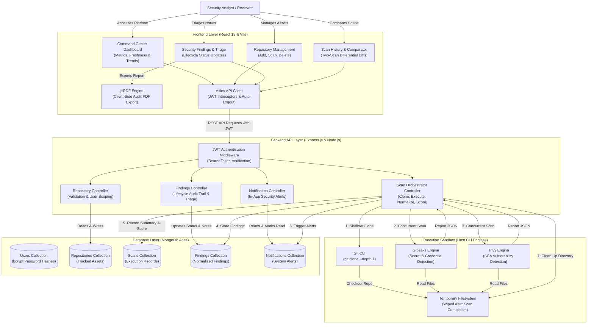

# SIH-Aligned Distributed Git Repository Security Scan Dashboard

> **Domain:** DevSecOps / Cloud Security & Web Application Engineering  
> **Academic Context:** 5th Semester Computer Science Major Project Review  
> **Project Focus:** Security Auditing, Credential Leak Prevention, and Dependency Vulnerability Management for Open-Source Government Software Contributions  

[](https://nodejs.org/)
[](https://react.dev/)
[](https://expressjs.com/)
[](https://www.mongodb.com/)
[](https://github.com/aquasecurity/trivy)

---

## Table of Contents

- [1. Executive Summary](#1-executive-summary)
- [2. Problem Statement & SIH Alignment](#2-problem-statement--sih-alignment)
- [3. Project Objectives](#3-project-objectives)
- [4. Key Capabilities](#4-key-capabilities)
- [5. System Architecture](#5-system-architecture)
  - [Architecture Overview](#architecture-overview)
  - [Architectural Flow Diagram](#architectural-flow-diagram)
- [6. Technology Stack](#6-technology-stack)
- [7. Dashboard Modules & Feature Breakdown](#7-dashboard-modules--feature-breakdown)
  - [DevSecOps Command Center (Dashboard)](#devsecops-command-center-dashboard)
  - [Repository Management](#repository-management)
  - [Security Findings & Triage](#security-findings--triage)
  - [Security Analytics & Telemetry](#security-analytics--telemetry)
  - [Scan History & Two-Scan Comparator](#scan-history--two-scan-comparator)
  - [In-App Notifications](#in-app-notifications)
  - [System Settings & Architecture Reference](#system-settings--architecture-reference)
  - [PDF Report Generation](#pdf-report-generation)
- [8. Security Scanner Integration](#8-security-scanner-integration)
  - [Gitleaks Secret Detection](#gitleaks-secret-detection)
  - [Trivy Vulnerability Scanner](#trivy-vulnerability-scanner)
  - [Scanner Error Handling & Resilience](#scanner-error-handling--resilience)
- [9. Repository Security Health Scoring Formula](#9-repository-security-health-scoring-formula)
- [10. Directory Structure](#10-directory-structure)
- [11. Prerequisites & Environment Setup](#11-prerequisites--environment-setup)
- [12. Installation & Running Instructions](#12-installation--running-instructions)
  - [Automated Root Concurrency](#automated-root-concurrency)
  - [Independent Service Startup](#independent-service-startup)
- [13. Environment Variables Reference](#13-environment-variables-reference)
- [14. End-to-End User Walkthrough](#14-end-to-end-user-walkthrough)
- [15. Comprehensive API Documentation](#15-comprehensive-api-documentation)
- [16. User Interface Gallery](#16-user-interface-gallery)
- [17. Security Considerations & Responsible Usage](#17-security-considerations--responsible-usage)
- [18. Known Limitations & Troubleshooting](#18-known-limitations--troubleshooting)
- [19. Testing & Build Commands](#19-testing--build-commands)
- [20. Future Enhancements (Planned Work)](#20-future-enhancements-planned-work)
- [21. Contributors](#21-contributors)
- [22. License](#22-license)

---

## 1. Executive Summary

The **SIH-Aligned Distributed Git Repository Security Scan Dashboard** is a centralized DevSecOps security management platform engineered to automate static security auditing across public and private Git repositories. Built with a React 19 single-page application, Node.js/Express backend, and MongoDB Atlas persistence, the system bridges the gap between raw command-line security tooling and actionable web-based vulnerability management.

Rather than developing custom vulnerability databases, the application directly orchestrates industry-standard, battle-tested open-source scanners:
* **Gitleaks** — Static secret detection engine identifying leaked API tokens, private keys, database connection URIs, and authentication tokens across source trees.
* **Trivy** — Software Composition Analysis (SCA) scanner mapping dependencies, lockfiles, and package manifests against National Vulnerability Database (NVD) Common Vulnerabilities and Exposures (CVE) records.

The platform provides continuous repository visibility, automated security health scoring (0–100 scale), scan freshness monitoring, vulnerability lifecycle management (`OPEN`, `IN_PROGRESS`, `RESOLVED`, `ACCEPTED_RISK`), two-scan differential comparison, real-time in-app notifications, and client-side PDF security audit export.

---

## 2. Problem Statement & SIH Alignment

Open-source government portals, digital public infrastructure (DPI), and public sector software projects frequently accept code contributions from diverse external developers. However, contributions often introduce critical security risks before detection:

1. **Accidental Credential Exposure:** Private keys, cloud infrastructure secrets (AWS, Azure, GCP), government API gateway tokens, and internal database connection strings accidentally committed to public branches.
2. **Vulnerable Third-Party Dependencies:** Upstream package vulnerabilities (CVEs) introduced through outdated npm, pip, Maven, or Go module dependencies that permit remote code execution (RCE) or denial-of-service.
3. **Decentralized Security Visibility:** In many academic and small-team government projects, security scanning is sporadic, manual, or locked inside developer terminals with no centralized historical audit trail or remediation tracking.

### Smart India Hackathon (SIH) Academic Problem Alignment
This project is aligned with the problem theme of **"Automated Security Auditing for Public Digital Infrastructure Contributions."** It serves as an academic 5th-semester major project submission demonstrating how automated scanning workflows, vulnerability lifecycle tracking, and standardized scoring can be applied to maintain baseline code hygiene before merging contributions into public-facing codebases.

> [!NOTE]
> *Disclaimer:* SIH alignment denotes the project's conceptual and educational problem theme. The dashboard is an academic implementation designed for laboratory evaluation, developer triage, and educational demonstration; it does not claim formal government endorsement or production accreditation.

---

## 3. Project Objectives

- **Automate Multi-Scanner Orchestration:** Execute Gitleaks and Trivy sequentially/concurrently against isolated shallow Git clones without manual CLI intervention.
- **Normalize Heterogeneous Findings:** Transform varied scanner outputs (Gitleaks JSON, Trivy SCA reports) into a uniform MongoDB finding schema with standardized severity levels (`CRITICAL`, `HIGH`, `MEDIUM`, `LOW`).
- **Provide Actionable Triage:** Facilitate vulnerability lifecycle management allowing security analysts to transition finding states, document remediation notes, and preserve an audit log.
- **Quantify Risk Posture:** Calculate an objective, severity-weighted Security Health Score (0–100) per repository and globally across all tracked assets.
- **Detect Drift and Regression:** Implement scan-to-scan comparison to detect newly introduced flaws, persistent vulnerabilities, and verified fixes across commits.
- **Enable Portable Reporting:** Generate clean, print-ready PDF audit reports for project reviewers, security officers, and academic evaluators directly in the browser.

---

## 4. Key Capabilities

| Capability | Description |
|---|---|
| **Multi-Scanner Engine** | Integrates Gitleaks for secret detection and Trivy for dependency SCA in a unified pipeline. |
| **Command Center Dashboard** | KPI metric cards, scan freshness tracker, Recharts visual telemetry, repository risk table, and dynamic recommended actions. |
| **Vulnerability Lifecycle** | Manage findings across `OPEN`, `IN_PROGRESS`, `RESOLVED`, and `ACCEPTED_RISK` states with mandatory remediation audit logs. |
| **Security Health Scoring** | Dynamic 0–100 heuristic score derived from weighted vulnerability penalties; findings marked `RESOLVED` incur zero penalty. |
| **Scan Freshness Tracking** | Automatically flags repositories as `FRESH` (scanned < 7 days), `STALE` (> 7 days), or `NEVER_SCANNED`. |
| **Scan Comparator** | Compares two scans from the same repository to identify new, persistent, and fixed findings using stable structural fingerprints. |
| **Fail-Safe Delta Logic** | Guarantees that findings are never falsely marked as fixed when a target scan fails or aborts. |
| **Client-Side PDF Export** | Generates professional PDF security audit summaries with severity distribution, scanner source, and file locations. |
| **In-App Notification Feed** | Automated alerts triggered on scan completion, critical vulnerability detection, scan failures, and triage status changes. |
| **JWT Authentication** | Secure token-based access control with bcrypt password hashing, per-user data isolation, and auto-logout on token expiration. |
| **Prismatic Cybersecurity UI** | High-contrast light design system featuring soft radial glows, `.card-prismatic` surfaces, and SVG gradient data charts. |

---

## 5. System Architecture

### Architecture Overview

The application follows a decoupled three-tier architecture:
1. **Presentation Layer (Frontend):** React 19 single-page application bootstrapped with Vite, featuring route-level code splitting via `React.lazy`, client-side routing with `react-router-dom` v7, visual analytics via `recharts`, and PDF compilation via `jspdf` / `jspdf-autotable`.
2. **API & Orchestration Layer (Backend):** Node.js / Express.js REST API providing JWT authentication, repository tracking, notification delivery, and child process execution (`child_process.spawn`) for Git, Gitleaks, and Trivy.
3. **Data Layer (MongoDB Atlas):** Document persistence utilizing Mongoose ODM with composite indexing for high-speed aggregations, user isolation, and finding lookups.

### Architectural Flow Diagram



---

## 6. Technology Stack

### Frontend Architecture
| Component | Technology | Version | Purpose |
|---|---|---|---|
| Framework | **React** | `^19.2.8` | Component-based interactive user interface |
| Build System | **Vite** | `^8.3.0` | High-speed ESM bundler and development proxy |
| Client Routing | **React Router DOM** | `^7.18.4` | Declarative client-side routing with lazy loading |
| HTTP Client | **Axios** | `^1.20.0` | Request/response interceptors and token injection |
| Data Visualizations | **Recharts** | `^3.10.1` | SVG charts with custom linear gradients and tooltips |
| Iconography | **Lucide React** | `^1.48.0` | Cybersecurity and operational system icons |
| PDF Export | **jsPDF & AutoTable** | `^4.2.1` / `^5.0.8` | Client-side vector and tabular security report rendering |
| Linter | **Oxlint** | `^1.81.0` | High-performance JavaScript/JSX code linting |

### Backend Architecture
| Component | Technology | Version | Purpose |
|---|---|---|---|
| Runtime | **Node.js** | `>= 18.0.0` | Asynchronous JavaScript runtime environment |
| Framework | **Express.js** | `^4.21.2` | RESTful routing and centralized error handling |
| Database ODM | **Mongoose** | `^8.23.0` | Document schema modeling, indexing, and validation |
| Authentication | **jsonwebtoken (JWT)** | `^9.0.3` | Cryptographically signed stateless bearer tokens |
| Cryptography | **bcryptjs** | `^3.0.3` | Salted SHA-512 password hashing |
| Network Compression | **compression** | `^1.8.2` | Gzip/Deflate compression for high-volume payloads |
| CORS Security | **cors** | `^2.8.5` | Cross-Origin Resource Sharing control |
| Configuration | **dotenv** | `^17.3.1` | Environment variable management |
| Dev Server | **Nodemon** | `^3.1.14` | Hot-reloading daemon for backend server scripts |

### Security Engines & System Tools
| Tool | Minimum Version | Operating Mode | Responsibility |
|---|---|---|---|
| **Git** | `>= 2.30.0` | CLI Subprocess | Shallow cloning (`--depth 1`) with prompt suppression |
| **Gitleaks** | `>= 8.18.0` | CLI Subprocess | Detect hardcoded API tokens, private keys, and secrets |
| **Trivy** | `>= 0.48.0` | CLI Subprocess | Software composition analysis on filesystem manifests |

---

## 7. Dashboard Modules & Feature Breakdown

### DevSecOps Command Center (Dashboard)
Located at `/dashboard`, this view serves as the primary security operations center:
* **Command Center Hero:** Real-time system greeting, live scanner engine readiness badge, and direct primary action to initiate scans.
* **5 Key Telemetry Metric Cards:**
  1. *Tracked Repositories:* Total monitored GitHub assets.
  2. *Open Critical Vulnerabilities:* Unresolved Critical findings requiring immediate action.
  3. *Unresolved Vulnerabilities:* Total active issues across `OPEN` and `IN_PROGRESS` states.
  4. *Resolved Issues:* Flaws remediated or mitigated.
  5. *Overall Security Health Score:* Weighted composite score (0–100%) with letter grade (`A`, `B`, `C`, `D`).
* **Scan Freshness Tracker:** Categorizes assets into Fresh (scanned within 7 days), Stale (> 7 days), and Never Scanned.
* **Interactive Charting Suite:**
  * *Severity Distribution:* Categorized bar chart representing Critical, High, Medium, and Low vulnerabilities.
  * *Scan History Trend:* Chronological multi-line trend showing vulnerability discovery rates over time.
  * *Newly Detected vs. Resolved:* Stacked lifecycle comparison chart.
* **Repository Risk Table:** Tabular breakdown displaying repository name, owner, branch, freshness badge, scan status, open critical/high counts, security score, and a direct link to findings.
* **Automated Recommended Actions:** Dynamically generated advisories prioritizing:
  1. Retrying failed scans.
  2. Triaging open critical secrets and CVEs.
  3. Scanning never-scanned repositories.
  4. Refreshing stale scan baselines.
* **Automated Latest Scan Comparison:** Summarizes the score delta, new flaws, persistent flaws, and fixed flaws between the two most recent scans of the same repository.
* **Global Filters:** Dynamically filter dashboard data by Repository, Time Range (`7d`, `30d`, `ALL`), Severity, Scanner, and Lifecycle Status.

### Repository Management
Located at `/repositories`:
* Add GitHub repositories via public HTTPS URLs (e.g., `https://github.com/owner/repository`).
* Specify target branches (defaults to `main` with automated fallback if default differs).
* Track last-scanned timestamp, repository visibility (`public` / `private`), and creation date.
* Trigger on-demand security scans with live UI progress indicators (`QUEUED` $\to$ `RUNNING` $\to$ `COMPLETED` / `FAILED`).
* Safe repository deletion with cascading cleanup restrictions.

### Security Findings & Triage
Located at `/findings`:
* Display all detected security findings with granular filtering: by Repository, Scan ID, Severity, Scanner (`GITLEAKS` / `TRIVY`), and Status (`OPEN`, `IN_PROGRESS`, `RESOLVED`, `ACCEPTED_RISK`), plus text search.
* **Finding Cards Detail:**
  * Scanner engine badge (`GITLEAKS` in magenta, `TRIVY` in cyan).
  * Severity badge with accessible light-contrast color coding.
  * Secret masking: Gitleaks secrets display only the first 3 and last 2 characters (e.g., `ghp****3a`), preventing credential leakage during screen sharing.
  * Precise file path and starting line number (when reported by the scanner).
  * Vulnerability identifier (CVE-YYYY-NNNN or Gitleaks Rule ID).
  * Actionable remediation advice and upstream advisory links.
* **Vulnerability Lifecycle Management Modal:**
  * Transition finding status between `OPEN`, `IN_PROGRESS`, `RESOLVED`, and `ACCEPTED_RISK`.
  * Add custom remediation notes explaining mitigation or patch steps.
  * Appends every update to an immutable `statusHistory` audit trail storing the timestamp and user ID.
  * Findings marked `RESOLVED` automatically remove score penalties.

### Security Analytics & Telemetry
Located at `/analytics`:
* Global vulnerability resolution rate percentage.
* 5 Recharts visualizations:
  1. *Severity Breakdown Bar Chart.*
  2. *Vulnerability Lifecycle Distribution (Donut Chart).*
  3. *Repository Vulnerability Comparison (Grouped Bar Chart).*
  4. *Scan History Trend Timeline (Area Chart).*
  5. *Scanner Engine Coverage (Donut Chart).*

### Scan History & Two-Scan Comparator
Located at `/scan-history`:
* **Scan History Log:** Paginated list of historical scan executions with durations, completion timestamps, findings breakdown, and computed security score.
* **Differential Scan Comparator:**
  * Select two arbitrary scans from the same repository (Base Scan vs. Target Scan).
  * Calculates score delta ($\Delta = \text{Target} - \text{Base}$).
  * Categorizes findings into **Newly Detected**, **Persistent**, and **Fixed**.
  * Matches findings using stable structural fingerprints (`scanner:identifier:file:line`).
  * **Integrity Guard:** Strictly forbids marking findings as "fixed" if the target scan failed or aborted.

### In-App Notifications
Located at `/notifications` and accessible from the header bell icon:
* Live badge indicating unread notification count.
* Automatically generated notifications for:
  * `CRITICAL_FINDINGS`: High-urgency alert when critical CVEs or secrets are discovered.
  * `SCAN_COMPLETED`: Confirmation of successful scan execution with duration and count.
  * `SCAN_FAILED`: Diagnostic alert detailing clone timeout or scanner failure.
  * `STATUS_CHANGED`: Audit notification when a team member modifies a finding's status.
* Mark individual items as read or execute "Mark All as Read".
* Direct contextual hyperlinks leading straight to the affected scan or finding.

### System Settings & Architecture Reference
Located at `/settings`:
* Active operator session details (analyst name, email, role, token authentication scheme).
* Academic problem statement context and SIH alignment documentation.
* Real-time operational status of the Gitleaks and Trivy scanner binaries on the host system.
* Formal mathematical breakdown of the Repository Security Score formulation.

### PDF Report Generation
Integrated directly into the Findings page:
* Click **Download PDF** to export a formatted security audit document generated entirely client-side using `jspdf` and `jspdf-autotable`.
* Includes application header, target repository URL, branch, scan timestamp, execution status, total findings, severity distribution summary, and a detailed table of every finding with its file path, severity, and remediation guidance.
* Respects active UI search queries and dropdown filters.

---

## 8. Security Scanner Integration

### Gitleaks Secret Detection
* **Execution Command:**
  ```powershell
  gitleaks detect --source <repo_temp_path> --report-format json --report-path - --no-git
  ```
* **Binary Discovery:** Evaluates `process.env.GITLEAKS_PATH`, system `PATH`, and standard Windows WinGet installation paths (`%LOCALAPPDATA%\Microsoft\WinGet\Packages\Gitleaks...`).
* **Execution Timeout:** Enforces a strict 60-second execution cap; hung processes are terminated with `SIGKILL`.
* **Output Handling:** Exit code `0` (clean) and exit code `1` (secrets detected) are both treated as successful completions.
* **Sensitive Data Redaction:** Secret values are sanitized prior to database insertion; raw secrets are never persisted in plaintext or exposed to frontend consumers.

### Trivy Vulnerability Scanner
* **Execution Command:**
  ```powershell
  trivy fs --format json --scanners vuln <repo_temp_path>
  ```
* **Binary Discovery:** Evaluates `process.env.TRIVY_PATH`, system `PATH`, and standard Windows WinGet installation paths (`%LOCALAPPDATA%\Microsoft\WinGet\Packages\AquaSecurity.Trivy...`).
* **Execution Timeout:** Enforces a strict 90-second execution cap.
* **Output Handling:** Parses `Results[].Vulnerabilities[]` from Trivy's structured JSON report, mapping CVE IDs, target package names, installed versions, fixed versions, and severity ratings.

### Scanner Error Handling & Resilience
* **Dual-Scanner Fault Tolerance:** If both scanners fail, the scan transitions to `FAILED` with detailed diagnostic error logs; the dashboard never reports false success. If one scanner encounters an issue while the other succeeds, findings from the healthy scanner are saved and a partial execution warning is recorded.
* **Stale Scan Recovery:** Scans remaining in `RUNNING` status for longer than 5 minutes (e.g., following an abrupt server restart) are automatically flagged as `FAILED` during the next scan request, clearing UI deadlocks.
* **Duplicate Scan Prevention:** Returns an HTTP `409 Conflict` if an analyst attempts to trigger a concurrent scan on a repository that is already actively scanning.
* **Prompt Protection:** Repository clones execute with `GIT_TERMINAL_PROMPT=0` and `GIT_ASKPASS=echo` to prevent processes from freezing on private repository authentication prompts.

---

## 9. Repository Security Health Scoring Formula

The platform calculates a standardized **0 to 100 Security Health Score** to objectively grade repository security hygiene.

### Mathematical Formulation
$$\text{Score} = \max\left(0, \min\left(100, 100 - \sum \text{Deductions}\right)\right)$$

Where deductions are calculated per active finding:
* **Critical Severity Finding:** $-25\text{ points}$
* **High Severity Finding:** $-15\text{ points}$
* **Medium Severity Finding:** $-5\text{ points}$
* **Low Severity Finding:** $-2\text{ points}$
* **Accepted Risk Status:** $-1\text{ point}$ (regardless of severity)
* **Resolved Status:** $0\text{ points}$ (penalties are immediately restored upon verification)

### Grade Classification

| Score Range | Letter Grade | Risk Classification | Recommended Action |
|:---:|:---:|---|---|
| **90 – 100%** | **Grade A** | Low Risk / Clean Posture | Ready for pull-request review or release |
| **75 – 89%** | **Grade B** | Moderate Risk | Triage advised; address high-severity warnings |
| **50 – 74%** | **Grade C** | Elevated Risk | Action required; critical vulnerabilities present |
| **0 – 49%** | **Grade D** | Critical Risk | Urgent remediation required; block production merges |

> [!NOTE]
> This scoring model is an internal heuristic indicator designed for academic prioritization and developer triage. It is not an official ISO/IEC 27001 or NIST certification score.

---

## 10. Directory Structure

```text
git-security-dashboard/
├── .env.example                       # Root environment template reference
├── .gitignore                         # Root Git ignore rules
├── package.json                       # Root orchestration package (concurrently runner)
├── package-lock.json                  # Root lockfile
├── README.md                          # Comprehensive project documentation
│
├── backend/                           # Node.js + Express REST API
│   ├── .env                           # Local backend environment file (git-ignored)
│   ├── .env.example                   # Backend environment template
│   ├── .gitignore                     # Backend-specific ignore rules
│   ├── package.json                   # Backend dependencies & run scripts
│   ├── package-lock.json              # Backend lockfile
│   ├── server.js                      # Application entrypoint & DB connection bootstrap
│   │
│   ├── src/
│   │   ├── app.js                     # Express app setup, compression & route mounting
│   │   ├── config/
│   │   │   └── db.js                  # Mongoose MongoDB connection handler
│   │   ├── controllers/
│   │   │   ├── auth.controller.js     # User registration, login, profile, password reset
│   │   │   ├── notification.controller.js # Notification retrieval and read-state management
│   │   │   ├── repository.controller.js   # Repository CRUD & GitHub URL validation
│   │   │   └── scan.controller.js     # Clone, orchestrate scanners, scoring, analytics, compare
│   │   ├── middleware/
│   │   │   └── auth.js                # JWT Bearer token verification middleware
│   │   ├── models/
│   │   │   ├── Finding.js             # Security finding schema, fingerprints & status history
│   │   │   ├── Notification.js        # In-app notification alert schema
│   │   │   ├── Repository.js          # Tracked repository schema & unique user index
│   │   │   ├── Scan.js                # Scan execution metrics & summary schema
│   │   │   └── User.js                # User identity schema & bcrypt passwordHash
│   │   ├── routes/
│   │   │   ├── auth.routes.js         # /api/auth routes
│   │   │   ├── finding.routes.js      # /api/findings routes
│   │   │   ├── health.routes.js       # /api/health route
│   │   │   ├── notification.routes.js # /api/notifications routes
│   │   │   ├── repository.routes.js   # /api/repositories routes
│   │   │   └── scan.routes.js         # /api/scans routes
│   │   └── services/
│   │       ├── gitleaks.service.js    # Gitleaks execution adapter & path resolver
│   │       └── trivy.service.js       # Trivy execution adapter & path resolver
│   │
│   ├── benchmark-performance.js       # Automated backend performance benchmark suite
│   ├── test-api-e2e.js                # Auth and repository API test suite
│   ├── test-dashboard-e2e.js          # DevSecOps Command Center comprehensive E2E suite
│   ├── test-pdf-and-navigation.js     # Findings export & navigation test suite
│   ├── test-security.js               # Security enforcement & injection test suite
│   ├── test-upgrade-e2e.js            # Lifecycle triage & scan comparator test suite
│   └── test-workflow.js               # Full scan execution workflow test suite
│
└── frontend/                          # React 19 + Vite Single-Page Application
    ├── .env.example                   # Frontend environment template
    ├── .gitignore                     # Frontend-specific ignore rules
    ├── index.html                     # HTML5 single-page application shell
    ├── package.json                   # Frontend dependencies & build scripts
    ├── package-lock.json              # Frontend lockfile
    ├── vite.config.js                 # Vite config, dev reverse proxy & Rollup manual chunks
    │
    └── src/
        ├── main.jsx                   # React root mount entrypoint
        ├── App.jsx                    # Route-level code-splitting & layout routing
        ├── index.css                  # Prismatic Cybersecurity design system tokens & glows
        │
        ├── components/
        │   ├── common/                # Shared UI elements
        │   └── layout/
        │       ├── AuthLayout.jsx     # Ambient glow layout for login/register
        │       ├── DashboardLayout.jsx# Protected shell with auto-token expiration check
        │       ├── Navbar.jsx         # Glassmorphic header, engine status & user menu
        │       └── Sidebar.jsx        # Navigation sidebar with active gradient pills
        │
        ├── pages/
        │   ├── Analytics.jsx          # Security telemetry, Recharts graphs & scanner split
        │   ├── Dashboard.jsx          # DevSecOps Command Center, risk table & advisories
        │   ├── Findings.jsx           # Findings list, filters, triage modal & PDF export
        │   ├── ForgotPassword.jsx     # Development mode password reset view
        │   ├── Login.jsx              # User sign-in view
        │   ├── Notifications.jsx      # In-app notifications list & filter tabs
        │   ├── Register.jsx           # User account creation view
        │   ├── Repositories.jsx       # Repository list, add modal & scan triggers
        │   ├── ScanHistory.jsx        # Scan execution logs & two-scan comparator UI
        │   └── Settings.jsx           # System settings, engine status & scoring docs
        │
        ├── services/
        │   └── api.js                 # Axios instance with auth interceptor & 401 redirect
        └── utils/
            └── pdfGenerator.js        # jsPDF + AutoTable security report generator
```

---

## 11. Prerequisites & Environment Setup

Before installing and running the application, ensure the following software is installed on your workstation:

### 1. Node.js & npm
* **Node.js:** `v18.x` or `v20.x` (LTS recommended)
* **npm:** `v9.x` or `v10.x`
* Verify installation:
  ```powershell
  node --version
  npm --version
  ```

### 2. Git
* Required for cloning repositories into temporary scan directories:
  ```powershell
  git --version
  ```

### 3. MongoDB
* Either a local MongoDB instance running on `mongodb://localhost:27017` or a free cloud cluster from [MongoDB Atlas](https://www.mongodb.com/cloud/atlas).

### 4. Security Scanners (Trivy & Gitleaks)
To enable real scanning, install Trivy and Gitleaks on your host operating system:

#### Windows (via WinGet)
Open PowerShell as an Administrator or regular user:
```powershell
# Install Gitleaks
winget install Gitleaks.Gitleaks

# Install Trivy
winget install AquaSecurity.Trivy
```
*Verify scanners are executable:*
```powershell
gitleaks version
trivy --version
```
*(The backend automatically scans standard WinGet directory paths if the tools are not registered in your system `PATH`.)*

#### Linux / macOS Notes
* **macOS (via Homebrew):**
  ```bash
  brew install gitleaks trivy
  ```
* **Linux (Ubuntu/Debian):**
  ```bash
  # Gitleaks
  sudo apt-get install gitleaks # Or download binary from GitHub Releases
  # Trivy
  sudo apt-get install wget apt-transport-https gnupg lsb-release
  wget -qO - https://aquasecurity.github.io/trivy-repo/deb/public.key | sudo apt-key add -
  echo deb https://aquasecurity.github.io/trivy-repo/deb $(lsb_release -sc) main | sudo tee -a /etc/apt/sources.list.d/trivy.list
  sudo apt-get update && sudo apt-get install trivy
  ```

---

## 12. Installation & Running Instructions

### Automated Root Concurrency (Recommended)

1. **Clone the repository:**
   ```powershell
   git clone <your-repository-url>
   cd "git security dashboard"
   ```

2. **Install all dependencies (Root, Backend, Frontend):**
   ```powershell
   npm run install:all
   ```

3. **Configure Environment Variables:**
   Create `.env` in the `backend/` directory based on `backend/.env.example`:
   ```powershell
   Copy-Item backend\.env.example backend\.env
   ```
   *(Update `backend/.env` with your MongoDB connection string and a secret `JWT_SECRET`.)*

4. **Start Both Services Concurrently:**
   ```powershell
   npm run dev
   ```
   * Backend will listen at: `http://localhost:5000`
   * Frontend will launch at: `http://localhost:5173`

---

### Independent Service Startup

If you prefer running frontend and backend in separate terminal windows:

#### Terminal 1 — Backend API
```powershell
cd backend
npm install
npm run dev
```
* Backend starts with Nodemon auto-reloading at `http://localhost:5000`.
* Verify API health: `http://localhost:5000/api/health`

#### Terminal 2 — Frontend Application
```powershell
cd frontend
npm install
npm run dev
```
* Frontend starts with Vite at `http://localhost:5173`.
* Requests to `/api/*` are automatically proxied to `http://localhost:5000`.

---

## 13. Environment Variables Reference

### Backend Configuration (`backend/.env`)

| Variable | Required | Default / Example Value | Description |
|---|:---:|---|---|
| `PORT` | Optional | `5000` | Port for Express HTTP server |
| `NODE_ENV` | Optional | `development` | Environment mode (`development` or `production`) |
| `CLIENT_URL` | Optional | `http://localhost:5173` | Allowed CORS origin for frontend client requests |
| `MONGO_URI` | **Required** | `mongodb://localhost:27017/git_security_dashboard` | MongoDB connection URI (local or MongoDB Atlas connection string) |
| `JWT_SECRET` | **Required** | `your_jwt_secret_key_change_in_production` | Cryptographic secret key used to sign and verify JWT tokens |
| `JWT_EXPIRES_IN` | Optional | `7d` | Token expiration duration string |
| `SCAN_TEMP_DIR` | Optional | `./temp_scans` | Path to store temporary repository clones during scan runs |
| `GITLEAKS_PATH` | Optional | `gitleaks` | Explicit path to Gitleaks binary if not located in system PATH |
| `TRIVY_PATH` | Optional | `trivy` | Explicit path to Trivy binary if not located in system PATH |

> [!CAUTION]
> **Security Notice:** Never commit actual `.env` files or production credentials to version control. Keep `.env` listed in `.gitignore` at all times.

### Frontend Configuration (`frontend/.env.example`)

| Variable | Required | Default Value | Description |
|---|:---:|---|---|
| `VITE_API_BASE_URL` | Optional | `/api` | Base API route prefix proxied to the backend by Vite |

---

## 14. End-to-End User Walkthrough

```text
  [1. Register / Sign In]
           │
           ▼
  [2. Add Target Repository] ────► Validates GitHub URL & branch
           │
           ▼
  [3. Trigger Security Scan] ────► Shallow clone to temp folder
           │                       Runs Gitleaks + Trivy concurrently
           ▼
  [4. Review Findings] ──────────► Inspect masked secrets & CVEs
           │
           ▼
  [5. Triage Vulnerabilities] ───► Change status (OPEN ➔ RESOLVED)
           │                       Document remediation note in audit trail
           ▼
  [6. Review Analytics & Diffs] ─► Compare scans & evaluate score improvement
           │
           ▼
  [7. Export Audit PDF] ─────────► Download clean executive report
```

1. **Register & Log In:** Navigate to `http://localhost:5173/register`. Enter your name, email, and password ($\ge 6$ characters). On completion, you are automatically signed in and redirected to the `/dashboard`.
2. **Add a Repository:** Navigate to **Repositories** and click **+ Add Repository**. Paste a public GitHub repository link (e.g., `https://github.com/expressjs/express`), select the branch (default `main`), and click **Add Repository**.
3. **Trigger a Security Scan:** In the repository card or table row, click **Scan Now**. The dashboard initiates the scan, displaying a progress indicator. Within seconds, the status transitions to `COMPLETED`.
4. **Inspect Security Findings:** Click **View Findings** or navigate to **Security Findings**. Filter by severity (e.g., `Critical` or `High`) or scanner engine (`GITLEAKS` or `TRIVY`). Examine affected files, line numbers, and masked credentials.
5. **Manage Vulnerability Lifecycle:** Click **Update Status** on a finding. Select `IN_PROGRESS` while debugging, or `RESOLVED` once patched. Enter a mandatory remediation note (e.g., *"Upgraded package lodash to 4.17.21"*). Notice that marking an item as `RESOLVED` automatically recalculates your repository score.
6. **Compare Scan Results:** Navigate to **Scan History**, switch to the **Scan Comparator** tab, pick two different scans for the same repository, and click **Compare Scans** to verify newly fixed versus persistent flaws.
7. **Export PDF Report:** On the Findings page, click **Download PDF Report**. A formatted, printable PDF security audit document is generated and downloaded instantly.

---

## 15. Comprehensive API Documentation

All routes (except `/api/health` and public `/api/auth/*` endpoints) require a valid JWT token passed in the HTTP header:  
`Authorization: Bearer <your_jwt_token>`

### 1. System Health
| Method | Endpoint | Description | Auth Required | Request Body / Parameters |
|:---:|---|---|:---:|---|
| `GET` | `/api/health` | Health check endpoint | No | None |

### 2. Authentication (`/api/auth`)
| Method | Endpoint | Description | Auth Required | Request Body / Parameters |
|:---:|---|---|:---:|---|
| `POST` | `/api/auth/register` | Register a new user | No | `{"name": "Analyst", "email": "user@example.com", "password": "password123"}` |
| `POST` | `/api/auth/login` | Authenticate user & receive JWT | No | `{"email": "user@example.com", "password": "password123"}` |
| `POST` | `/api/auth/reset-password` | Development mode password reset | No | `{"email": "user@example.com", "newPassword": "newPassword123"}` |
| `GET` | `/api/auth/me` | Fetch authenticated user profile | Yes | None |

### 3. Repository Management (`/api/repositories`)
| Method | Endpoint | Description | Auth Required | Request Body / Parameters |
|:---:|---|---|:---:|---|
| `GET` | `/api/repositories` | List all user-owned repositories | Yes | None |
| `POST` | `/api/repositories` | Register a new repository | Yes | `{"url": "https://github.com/owner/repo", "branch": "main", "visibility": "public"}` |
| `GET` | `/api/repositories/:id` | Get single repository metadata | Yes | URL Param: `id` (ObjectId) |
| `DELETE` | `/api/repositories/:id` | Delete a repository | Yes | URL Param: `id` (ObjectId) |

### 4. Security Scans, Analytics & Scoring (`/api/scans`)
| Method | Endpoint | Description | Auth Required | Request Body / Parameters |
|:---:|---|---|:---:|---|
| `POST` | `/api/scans/:repositoryId` | Trigger security scan on repository | Yes | URL Param: `repositoryId` (ObjectId) |
| `GET` | `/api/scans/:repositoryId` | List scan history for repository | Yes | URL Param: `repositoryId` (ObjectId) |
| `GET` | `/api/scans/dashboard/stats` | DevSecOps Command Center metrics | Yes | Query: `repositoryId`, `timeRange`, `severity`, `scanner`, `status` |
| `GET` | `/api/scans/analytics` | Security analytics telemetry data | Yes | None |
| `GET` | `/api/scans/history` | Global scan history with scores | Yes | Query (optional): `repositoryId` |
| `POST` | `/api/scans/compare` | Compare two scans from same repo | Yes | `{"baseScanId": "scanId1", "targetScanId": "scanId2"}` |
| `GET` | `/api/scans/findings` | Get all findings across repositories | Yes | Query (optional): `scanId`, `repositoryId` |
| `GET` | `/api/scans/:scanId/findings` | Get findings for a specific scan | Yes | URL Param: `scanId` (ObjectId) |

### 5. Security Findings & Lifecycle (`/api/findings`)
| Method | Endpoint | Description | Auth Required | Request Body / Parameters |
|:---:|---|---|:---:|---|
| `GET` | `/api/findings` | Retrieve all security findings | Yes | Query (optional): `scanId`, `repositoryId` |
| `PATCH` | `/api/findings/:id/status` | Update finding lifecycle & notes | Yes | `{"status": "RESOLVED", "note": "Upgraded dependencies"}` |
| `GET` | `/api/findings/:scanId` | Retrieve scan-specific findings | Yes | URL Param: `scanId` (ObjectId) |

### 6. Notifications (`/api/notifications`)
| Method | Endpoint | Description | Auth Required | Request Body / Parameters |
|:---:|---|---|:---:|---|
| `GET` | `/api/notifications` | List user in-app notifications | Yes | None |
| `GET` | `/api/notifications/unread-count` | Fetch unread notification count | Yes | None |
| `PATCH` | `/api/notifications/mark-all-read` | Mark all notifications as read | Yes | None |
| `PATCH` | `/api/notifications/:id/read` | Mark a single notification read | Yes | URL Param: `id` (ObjectId) |

---

## 16. User Interface Gallery

| View | Description | Preview |
|---|---|:---:|
| **DevSecOps Command Center** | KPI summary cards, scan freshness indicator, severity & trend charts, repository risk table, and dynamic recommended actions. | *(Interface active at `/dashboard`)* |
| **Security Analytics** | High-level resolution rates, vulnerability lifecycle breakdown, and scanner comparison charts. | *(Interface active at `/analytics`)* |
| **Security Findings & Triage** | Tabular findings with severity badges, masked secret strings, and lifecycle update modal. | *(Interface active at `/findings`)* |
| **Scan History & Comparator** | Historical scan log with computed security scores and differential comparison mode. | *(Interface active at `/scan-history`)* |
| **Repository Management** | Registering GitHub assets, monitoring scan statuses, and triggering on-demand scans. | *(Interface active at `/repositories`)* |
| **PDF Security Audit Report** | Clean, printable client-side PDF document generated via jsPDF and AutoTable. | *(Generated on-demand)* |

---

## 17. Security Considerations & Responsible Usage

1. **Zero Secret Leakage:** Discovered credential tokens (AWS keys, GitHub tokens, database URIs) are masked at the service boundary before persistence. The UI and exported PDF reports only display masked patterns (e.g., `ghp****3a`).
2. **Command Injection Prevention:** Repository clone commands and scanner invocations execute using `child_process.spawn` with an array of arguments and `shell: false`. No user input is concatenated into an unescaped shell string.
3. **Data Isolation:** All database queries for repositories, scans, findings, and notifications enforce strict multi-tenant user scoping (`userId: req.user.id`). Users cannot view or scan repositories belonging to other accounts.
4. **Credential Safety during Git Clone:** Child processes suppress interactive terminal prompts via `GIT_TERMINAL_PROMPT=0` and `GIT_ASKPASS=echo`. Private repository scans that fail authentication fail gracefully without blocking the thread.
5. **Temporary File Sanitization:** Repositories are cloned into ephemeral directories inside the operating system's temporary directory (`os.tmpdir()/git-sec-scans/<scanId>`). A `finally` block ensures that the temporary directory is recursively deleted immediately after scanning.
6. **Responsible Usage Notice:** This dashboard is intended strictly for auditing repositories that you own or have explicit authorization to scan. Performing automated security assessments against third-party repositories without authorization may violate terms of service.

---

## 18. Known Limitations & Troubleshooting

### Known Limitations
* **Public vs. Private Repositories:** Currently, automated cloning supports public GitHub repositories out of the box. Scanning private repositories requires pre-configuring SSH keys on the host machine or providing a personal access token (PAT) in the clone URL.
* **Local Binary Requirement:** Security scans require `gitleaks` and `trivy` installed locally on the host machine where the Node.js backend is running.
* **Monolithic Synchronous Scan Execution:** Scans run as asynchronous child processes managed directly by Express.js. While duplicate scans on the same repository are blocked, scanning massive repositories with years of Git history may take several minutes.

### Common Troubleshooting Steps

#### 1. Scan fails immediately with "Unable to clone repository"
* Verify your workstation has an active internet connection.
* Confirm that the repository URL is public and formatted correctly: `https://github.com/owner/repo`.
* Check if Git is installed and available in your system PATH (`git --version`).

#### 2. Scan fails with "Both security scanners failed"
* Ensure Gitleaks and Trivy are installed.
* Test executing them in PowerShell:
  ```powershell
  gitleaks version
  trivy --version
  ```
* If installed via custom paths, set `GITLEAKS_PATH` and `TRIVY_PATH` explicitly in `backend/.env`.

#### 3. Backend fails to connect to MongoDB
* Check your `MONGO_URI` in `backend/.env`.
* If using MongoDB Atlas, ensure your current IP address is whitelisted in Atlas Network Access (`0.0.0.0/0` for development).
* If using local MongoDB, verify the MongoDB service is running (`mongod`).

#### 4. Frontend displays "Network Error" or 401 Unauthorized
* Verify the backend is running on `http://localhost:5000`.
* Check browser LocalStorage to verify a valid token exists under the key `token`.
* Clear your session by clicking **Logout** and logging in again.

---

## 19. Testing & Build Commands

The project includes automated end-to-end verification and performance benchmarking suites.

### Running Backend E2E Test Suites
From the `backend/` directory:
```powershell
# Run the DevSecOps Dashboard Command Center E2E test
node test-dashboard-e2e.js

# Run the Vulnerability Lifecycle & Scan Comparison test
node test-upgrade-e2e.js

# Run the API authentication and repository CRUD test
node test-api-e2e.js

# Run the security enforcement & injection prevention test
node test-security.js

# Run the backend performance benchmark suite
node benchmark-performance.js
```

### Building the Frontend for Production
From the `frontend/` directory:
```powershell
# Run Oxlint code verification
npm run lint

# Build production bundle with Vite & Rollup code-splitting
npm run build

# Preview production build locally
npm run preview
```

---

## 20. Future Enhancements (Planned Work)

The following architectural enhancements represent planned future milestones beyond the current 5th-semester project scope:

* [ ] **Distributed Job Queue Architecture:** Decouple scanning from the Express process by implementing BullMQ and Redis for background worker task distribution.
* [ ] **GitHub Webhook & CI/CD Integration:** Automatically trigger scans on GitHub Pull Request events via inbound webhooks.
* [ ] **Software Bill of Materials (SBOM) Export:** Add CycloneDX and SPDX JSON standard export options for supply-chain compliance.
* [ ] **Static Application Security Testing (SAST):** Integrate Semgrep or CodeQL for deeper static code analysis beyond secrets and dependencies.
* [ ] **Role-Based Access Control (RBAC):** Introduce distinct `Auditor`, `Developer`, and `Administrator` permission roles for enterprise collaboration.
* [ ] **Containerized Deployment:** Provide Dockerfile and `docker-compose.yml` configurations for one-command deployment across Kubernetes or cloud environments.

---

## 21. Contributors

* **Student Developer / Researcher:** 5th Semester Computer Science & Engineering Undergraduate
* **Domain:** Full-Stack Web Development, Cloud Security & DevSecOps Engineering
* **Project Context:** Academic Mini-Project & SIH Theme Alignment

---

## 22. License

This project is currently developed for academic review, demonstration, and evaluation purposes. A formal open-source license (such as MIT or Apache 2.0) will be designated prior to public distribution.

*Copyright &copy; 2026. All rights reserved.*
